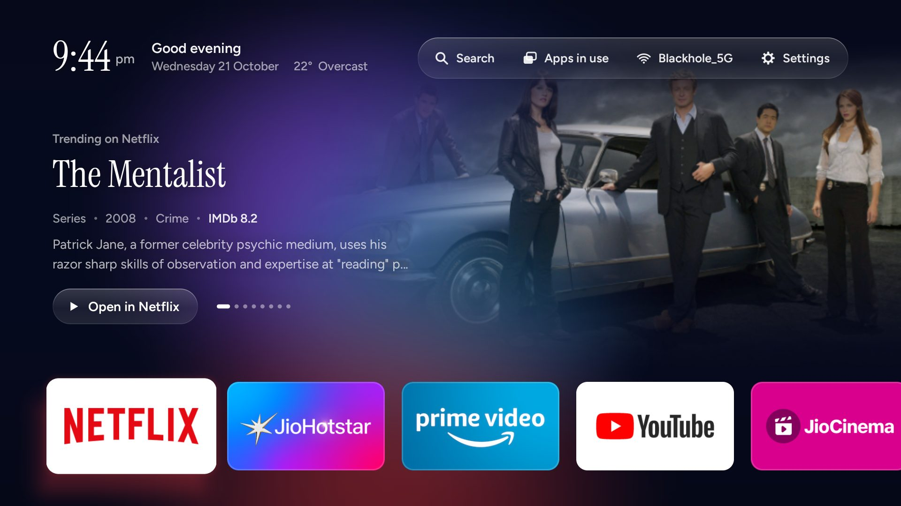
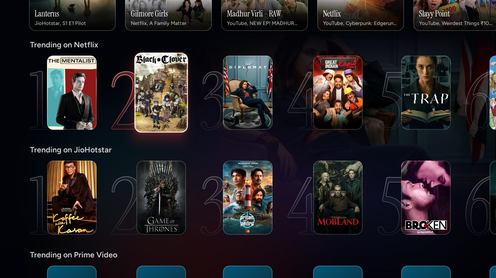
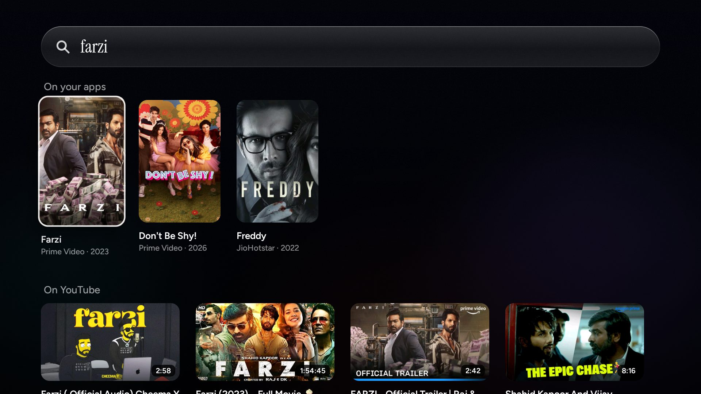
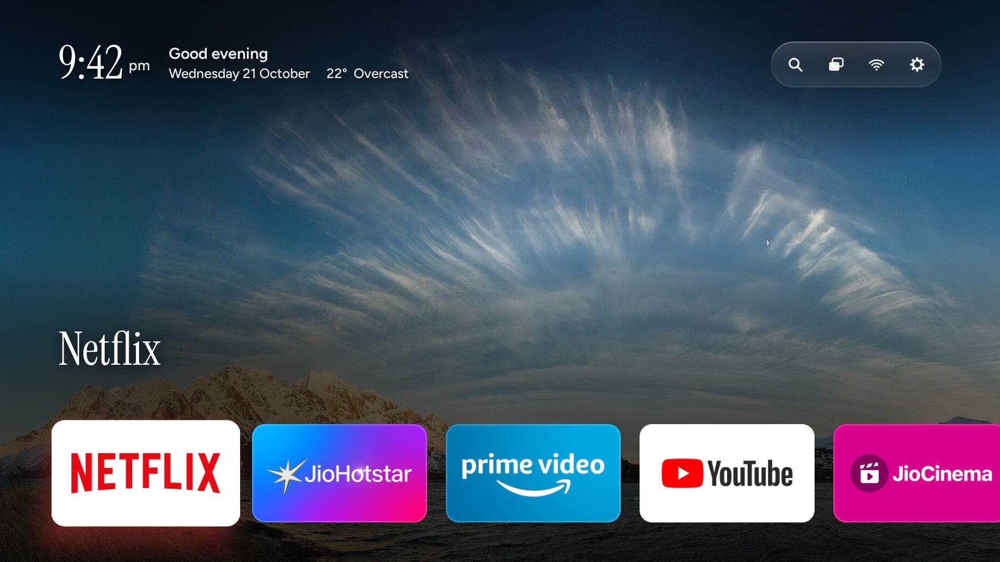
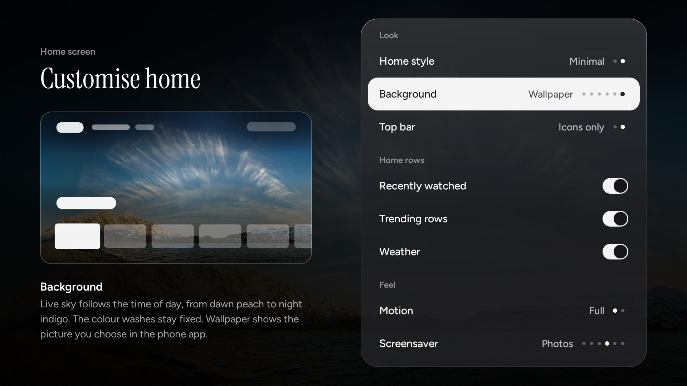
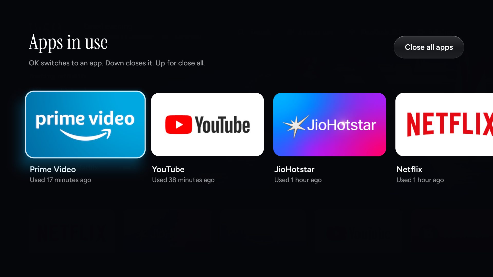
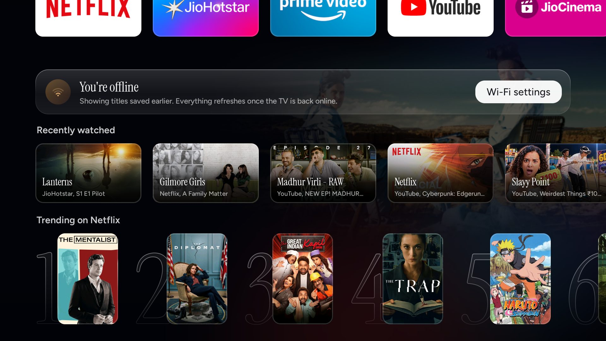
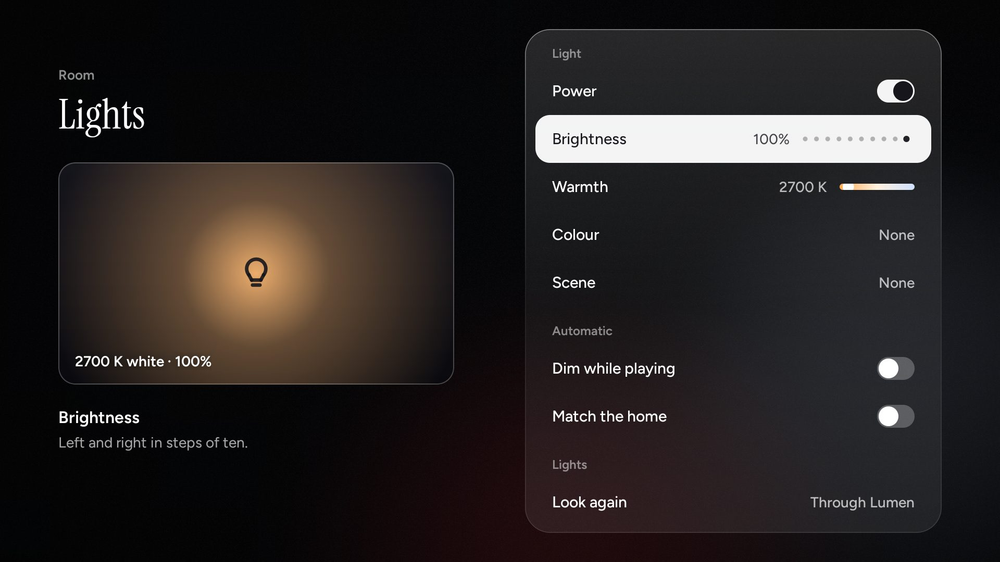
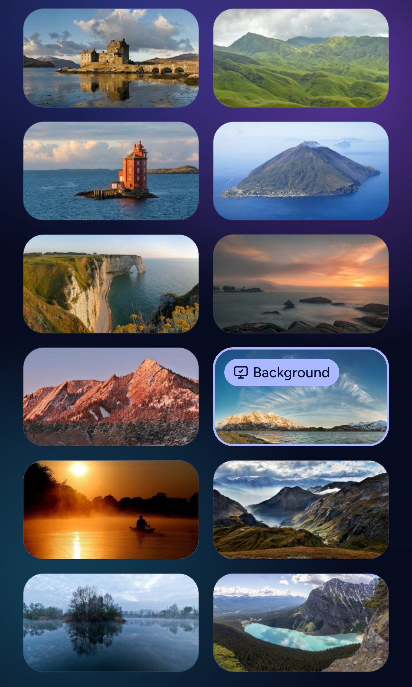

# Fireglass

**A fast, beautiful home screen for the Amazon Fire TV Stick, and a phone app that runs it.**
Debloat a slow Fire TV over Wi-Fi, replace Amazon's ad-filled home with an Apple TV-style one,
and control the TV from your phone with an on-device AI assistant. No root, nothing permanent,
nothing sent to anyone's cloud.



Built on a Fire TV Stick (3rd gen, 1 GB RAM, Fire OS 7.7), and reported working on Fire OS 8 (a Fire TV
Stick 4K Max). On the 3rd gen stick:

| | Amazon's home | Fireglass |
|---|---|---|
| Home screen memory | 129 MB | ~70 MB |
| Free storage (after debloat) | 0.8 GB | 2.1 GB |
| Free RAM | 180 MB | ~255 MB |
| Dropped frames moving along the apps row | stutters | 0.2–2% |

## What you get

**On the TV**

- **Featured titles.** What's trending on *your* apps (Netflix, Prime Video, JioHotstar, Zee5,
  SonyLIV, Apple TV, Crunchyroll) with art, facts and a two-line synopsis. Rest on an app and it
  narrows to that app's titles, like Apple TV's top shelf. "Open in Netflix" goes straight to
  the title inside the app.
- **One row of apps**, then **Recently watched** (tracked across apps, with the app and
  episode: Netflix and JioHotstar included) and a ranked **Trending on <app>** row for each app,
  Top 10 style: posters with their rank as a big serif numeral that lights up in the app's
  colour.
- **Search**, in the top bar: type with the Fire TV keyboard, or just ask Alexa. Results from the
  apps on this TV come first, then YouTube's own results. Alexa voice searches land here instead
  of on Amazon's results page.
- **Lights.** Your WiZ smart bulbs from the TV and the phone: power, brightness, warmth, colours
  and WiZ's scenes, plus two automatic modes: dim the room while something plays, and let the
  light take the colour of what you're on in the home.
- **Offline, calmly.** Without internet the home keeps working on what it saved, says so, offers
  Wi-Fi settings, and refreshes by itself once the TV is back online.
- **A live sky** behind everything that follows the time of day, a fixed colour wash, or one of
  your own pictures.
- **Apps in use**: a phone-style switcher. Switch to an app, push one away to close it, or
  close them all.
- **Customise home**: Featured or Minimal style, background, a top bar of labels or just icons
  (the name shows under the one you're on), which rows show, weather, calm motion, and the
  screensaver, each previewed live as you change it.
- **Screensavers**: a drifting clock, trending posters, your photos, the sky, or a different
  one each time.
- **Settings that work.** Fire OS hides most settings behind Amazon's home; Fireglass opens the
  ones it can directly and the rest through Amazon's Settings tab, then comes back.

| | |
|---|---|
|  |  |
|  |  |
|  |  |
|  | |

**On your phone** (Android, iOS)

- **Remote**: D-pad or touchpad, back/home/menu, media and volume, and a keyboard that types on
  the TV as you type. Key presses land in ~30 ms.
- **Assistant**: "play Mirzapur", "continue what I was watching", "put on lofi on YouTube",
  "down twice and select". A small open-source model (Qwen2.5 or LiquidAI LFM2.5) runs **on the
  phone**; simple commands work without one. It knows your watch history and asks before it
  resumes something.
- **Apps** and **Discover**: open any app, browse trending titles, tap to play on the TV.
- **Lights**: the same controls as the TV's, with sliders, from the Remote tab or Settings.
- **Wallpapers**: send pictures from your phone to the TV for the Photos screensaver, and pick
  one as the home background. The TV crops and resizes each to 1920x1080, and shades it softly
  where the clock and names sit so they stay readable.

| | | | | |
|---|---|---|---|---|
|  |  |  |  |  |

## How it works

```
 phone app ──HTTP (LAN, paired with a PIN)──► Fireglass on the TV ──► apps (deep links)
     │                                           │  RemoteServer :8090, mDNS _tvhome._tcp
     └──network ADB (once per boot)──► KeyServer │  HomeService (accessibility): Home button,
                                      (as shell) │    loading screen, now playing
                                                 │  Watching (notification listener): history
```

A few Fire OS walls and how Fireglass gets round them:

- **Amazon's launcher can't be replaced or disabled.** An accessibility service sees it come to the
  front and brings Fireglass back. Android holds an app's launches for ~5 s after a Home press,
  so the bounce goes through an alarm (system_server sends it, and is exempt) with the global
  `min_futurity=0`, which the installer sets. A loading screen, kept ready from the start, covers
  Amazon's home until Fireglass has drawn. Idea from [dumbtv](https://github.com/humblemuzzu/dumbtv).
  Fire OS 8 (Android 11) also blocks launches from the background unless the app has a window on
  screen, so there the alarm waits 300 ms for the loading screen to draw first.
- **Apps can't press keys on other apps, and Fire OS refuses ADB from the stick itself.** The
  phone starts a tiny key injector (`KeyServer`, run with `app_process` as the shell user) over
  network ADB once per boot. After that it injects in about a millisecond, where
  `input keyevent` takes 770 ms.
- **There's no cross-app watch history on Fire OS.** Apps do publish "now playing" for Alexa, so a
  notification listener reads it. Anything that plays for a minute is kept, with its app. Not
  every app says enough: Netflix names nothing while playing, but its "Continue watching" card for
  Amazon's home does, and the listener reads that. JioHotstar names only the episode, so the show
  comes from the content ids in its stream's path, looked up on Hotstar's content API (only the
  ids are sent; the stream URL carries your account's token).
- **Smart bulbs speak a local protocol, but not every router lets the TV hear them.** WiZ bulbs
  take JSON over UDP 38899 on the LAN, so the TV asks every address and talks to whatever answers.
  Some routers keep wireless devices apart (here the TV can't even resolve the bulb's address); then
  Fireglass goes through [Lumen](https://github.com/bhaweshverma50/lumen), a WiZ server on the LAN,
  if one is running.
- **Alexa's searches open Amazon's results page.** Its first line is what Alexa heard ("search for
  mirzapur"); the accessibility service covers the page, reads that, and opens Fireglass Search
  with the rest. Fire TV's YouTube app takes no search links, so YouTube results come from
  youtube.com's results page and open as videos.
- **The GPU is tiny.** Every full-screen blended layer costs 5–8 ms a frame on this Mali, so the
  featured picture is baked once into a hardware bitmap and nothing redraws the whole screen while
  you move.

The phone ↔ TV API is in [docs/remote-api.md](docs/remote-api.md). Pairing is guarded: a PIN takes
3 wrong guesses, and new PINs come at least 30 s apart, longer after repeated misses, so nothing
else on your Wi-Fi can run through all 10,000 PINs.

## Download

Prebuilt files are on the [latest release](https://github.com/bhaweshverma50/fireglass/releases/latest):

| File | For | Install |
|---|---|---|
| [Fireglass-Remote-1.3.0.apk](https://github.com/bhaweshverma50/fireglass/releases/download/v1.3.0/Fireglass-Remote-1.3.0.apk) | Android phone | Open it on the phone and allow installs from unknown sources |
| [Fireglass-Remote-1.3.0-unsigned.ipa](https://github.com/bhaweshverma50/fireglass/releases/download/v1.3.0/Fireglass-Remote-1.3.0-unsigned.ipa) | iPhone | Sideload with AltStore or Sideloadly, which sign it with your Apple ID |
| [Fireglass-TV-launcher-1.3.0.apk](https://github.com/bhaweshverma50/fireglass/releases/download/v1.3.0/Fireglass-TV-launcher-1.3.0.apk) | Fire TV (Fire OS 7 or 8) | `adb install -r` it, then do the grants and Home takeover at the end of [build-and-install.sh](launcher/build-and-install.sh). The setup below does all of this for you |

The APKs are signed with a local debug key. To install over a copy signed with a different key, uninstall it first.

## Set it up

You need a Mac (Linux works with small changes), a Fire TV Stick on the same Wi-Fi, and about
30 minutes.

1. **On the TV**: Settings → My Fire TV → About → press OK on your device name 7 times → back →
   Developer options → turn on **ADB debugging**.
2. **On the Mac**:

   ```bash
   git clone https://github.com/bhaweshverma50/fireglass && cd fireglass
   ./setup.sh                                   # JDK 17 + Android SDK (Homebrew)
   adb connect <tv-ip>:5555                      # accept "Allow USB debugging?" on the TV
   export ANDROID_SERIAL=<tv-ip>:5555
   launcher/build-and-install.sh                 # builds, installs, grants what it needs
   ```

   On JDK 21, build-tools 34's `d8` crashes; point the script at newer build-tools with
   `BUILD_TOOLS=<sdk>/build-tools/35.0.0`.

3. **Optional debloat** (reversible: packages are disabled, never uninstalled). Read the list
   first and keep what you use:

   ```bash
   while read -r p; do case "$p" in ''|\#*) ;; *) adb shell pm disable-user --user 0 "${p%% *}";; esac; done \
     < examples/fire-tv-stick-3rd-gen/debloat.txt
   ```

   Undo with `pm enable` on the same list.
4. **Phone app**: see [phone/README.md](phone/README.md). Open it on the same Wi-Fi, pick your TV,
   type the PIN the TV shows, and allow the phone on the TV once. Mistype it three times and the
   app asks the TV for a new one.

Change the shelf order on the TV itself (press ≡ on an app), or the defaults in
[launcher/res/values/config.xml](launcher/res/values/config.xml).

To go back to stock: `adb uninstall dev.bhawesh.tvhome`.

## What's here

| Path | What it is |
|---|---|
| [launcher/](launcher/) | The TV app. Plain Android Java, no Gradle, about 175 KB |
| [phone/](phone/) | The phone app. Expo / React Native, with `llama.rn` for the on-device model and a mock TV for development |
| [docs/remote-api.md](docs/remote-api.md) | The LAN API between them |
| [examples/](examples/) | Debloat lists (Fire TV Stick 3rd gen, and the original TCL Google TV one) |
| [tools/](tools/) | ADB helpers from tv-home (Python ADB client, find-tv, type) |

## Honest limits

- Amazon's home stays installed and comes back into memory now and then; Fire OS protects it.
- After Home, a loading screen shows for about 1 s (0.7–1.2 s measured) before Fireglass is back.
  Amazon's home doesn't show.
- `min_futurity=0` is global: any app's alarm set for the next few seconds fires on time instead
  of being pushed ~5 s out. `tools/restore.sh` removes it.
- Watch history only records what apps report or put on Amazon's home. An app that does neither
  isn't recorded.
- Trending titles and per-app links come from JustWatch's public API, which is unofficial and
  could change. So do the Hotstar content lookup and the YouTube results. Weather is from
  Open-Meteo, location from your IP via ip-api.com.
- Lights through Lumen need the machine running Lumen to be up; bulbs the TV can reach itself
  don't. Only WiZ bulbs are supported.
- After an Alexa voice search, Amazon's results page shows for a moment before the cover goes up:
  Fireglass only hears about it once it's drawn.
- Someone on your Wi-Fi can hold off new pairings for up to an hour by sending wrong PINs (they
  can't pair). Phones already paired keep working, and restarting the TV clears it.
- Tested on a Fire TV Stick 3rd gen in India; the Fire OS 8 fixes came from a 4K Max. Other regions
  need the country code in `Catalog.java`.

## Credits

Fireglass started as a fork of [tv-home](https://github.com/mihirgupta0900/tv-home) by Mihir Gupta
(MIT), an Apple TV-style launcher and debloat kit for Google TV. Fonts: Instrument Serif and
Figtree, both SIL Open Font License (licences in `launcher/assets/fonts/`). Icons in the phone
app: Lucide. Fire OS 8 support and the pairing limits: [@beenhere](https://github.com/beenhere).

The wallpaper in the screenshots is *Cirrus front over Austnesfjorden, Lofoten* by Ximonic (Simo
Räsänen), CC BY-SA 3.0, from Wikimedia Commons.

Built with [Claude Code](https://claude.com/claude-code).

## License

MIT. See [LICENSE](LICENSE).
